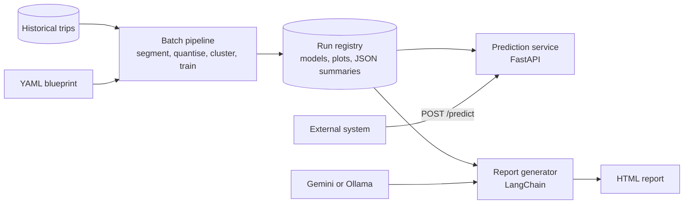

# DistETA: distribution-focused ETA analysis for container drayage

**Finds the recurring travel-time and dwell-time patterns in container drayage, classifies new trips into those patterns in real time through a FastAPI service, and turns each analysis run into an LLM-written report.**

This is a showcase repository. It describes a system I built in a university research project on port logistics (2024-2025). The source code and data are private because they belong to that research project; both can be walked through on request for interviews.

## The problem

An average travel time hides what a logistics planner needs to know: whether a trip is behaving like a normal day, a congested one or an outlier. Truck trips to and from a container port, and the time containers wait (dwell) in the terminal, are often skewed, multi-modal and different from one context to another (route, weekday, start hour, load). A single mean or a point ETA flattens all of that.

## The approach

DistETA works on the whole distribution of times instead of a single number.

1. **Segment.** Historical trips are grouped by categorical context (for example route, weekday, weight class and start hour). Rare combinations are filtered out automatically, by knee detection or a percentile cut.
2. **Quantise.** The continuous variable (travel or dwell time) is binned with the Freedman-Diaconis rule, so each segment becomes a comparable histogram.
3. **Cluster distributions.** K-Means groups segments whose time distributions look alike. K is chosen by silhouette score within a configured range, and each cluster is summarised by its high-density region (HDR), the interval where most of its trips fall.
4. **Classify.** An XGBoost classifier is trained per segment to assign a new trip to one of the discovered patterns, returning class probabilities rather than a single label.
5. **Serve.** A FastAPI service loads the latest trained models and answers prediction requests in real time; a simulation mode replays a dataset row by row.
6. **Report.** A LangChain report generator sends the run's JSON summaries and plots as one multimodal prompt to Google Gemini or a local Ollama vision model, and saves a Markdown and HTML report. Without an LLM it falls back to a plain report with the raw results.

The pipeline is config-driven and dataset-agnostic: each analysis is a YAML blueprint (input, grouping and categorical columns, the variable to analyse, units, labels), so the same code handles truck travel times and terminal dwell times.

## Architecture

The flow of data and artefacts between the three modules:



A run registry records each successful batch run, so the prediction service and the report generator always pick up the latest models and artefacts without hard-coded paths.

## Prediction API shape

An illustrative request (field values genericised):

```json
POST /predict
{
  "config": "travel_time_analysis",
  "instance_id": "trip-001",
  "categorical_features": {"route": "route_a", "weekday": "Tuesday", "weight_class": 3, "start_hour": 10},
  "continuous_features": {"total_time": 3.0}
}
```

The response carries the predicted pattern (cluster) for the trip's segment, the probability of each pattern and whether a plot of the trip against its pattern was generated. The service also exposes `GET /latest-plot` for a dashboard image panel and `POST /reload` to pick up a newer run.

## Tech stack

- **Data and ML:** Python 3.12, pandas, NumPy, scikit-learn (K-Means, silhouette), kneed, XGBoost
- **Visualisation:** Plotly and Kaleido (static PNG and interactive HTML)
- **Serving:** FastAPI, Uvicorn, Pydantic
- **LLM reporting:** LangChain with Google Gemini (cloud) or Ollama (local, multimodal)
- **Engineering:** YAML configuration with environment-variable overrides, Docker (multi-stage, non-root), GitHub Actions (lint, type checks, tests), pytest, ruff, mypy, pre-commit

## Results

- Distribution-focused clustering separates a small number of recurring operational patterns that a mean-based view hides.
- Each pattern comes with an interpretable high-density region, which gives planners a realistic time window instead of a single ETA.
- The LLM reports turn the clustering statistics and plots into a readable narrative with hypotheses for why each pattern exists, so non-technical stakeholders can use the results.

The methods and their evaluation are published in the papers below.

## Publications

- Lima, A., et al. (2025). Distribution-Focused Clustering for Revealing Patterns in Container Logistics. *Advances in Production Management Systems (APMS 2025)*, IFIP AICT, Springer. https://doi.org/10.1007/978-3-032-03515-8_18
- Lima, A., et al. (2026). Accurate Estimates of Drayage Dwell Times. Springer Proceedings in Mathematics and Statistics (PROMS). https://doi.org/10.1007/978-3-032-00914-2_53

## Source code and data

The source code and data are private: they come from a university research project and are not mine to publish. I am happy to walk through the code, the design decisions and the results in an interview; contact me through my GitHub or LinkedIn profile.

## Author

**André Lima**, AI and Data Engineer, Porto, Portugal. MSc in Data Science for Social Sciences, University of Aveiro.

[LinkedIn](https://www.linkedin.com/in/andre-lima-3927aa24/) · [GitHub](https://github.com/oarguido) · [ORCID](https://orcid.org/0000-0001-5505-1233)
